<!--
  Os cartões SVG só passam a existir depois da primeira execução do workflow
  cool-readme.yml, que publica os arquivos na branch `cards`.
  Sintaxe das imagens: seção "By hand" do README do github-cool-readme
  (https://github.com/pedrocatalao/github-cool-readme).
  Cada cartão tem 450x219 e deve ser exibido com width="400" (fica 400x195;
  dois cabem numa linha e, em telas estreitas, empilham).
  O cartão About não aceita links clicáveis; eles ficam nesta seção de contato.
-->

<!-- github-cool-readme: https://github.com/pedrocatalao/github-cool-readme -->

<h1 align="center">Ricardo Resende</h1>

  Desenvolvedor freelancer · Salvador, Bahia · Sistemas de Informação na UFBA

  <a href="https://brichard.dev/freelancer">Portfólio freelancer</a>
  ·
  <a href="https://www.linkedin.com/in/ricardo-guilherme-oliveira-resende/">LinkedIn</a>
  ·
  <a href="https://github.com/BRichardy">GitHub</a>

---

## Sobre

  <picture>
    <source media="(prefers-color-scheme: dark)" srcset="https://raw.githubusercontent.com/BRichardy/BRichardy/cards/about-dark.svg">
    
  </picture>

## Tecnologias

O cartão de linguagens abaixo reflete a mistura linguística dos repositórios no GitHub (ponderada pelos commits). A stack com que trabalho no dia a dia inclui:

`Flutter` `Dart` `React Native` `Expo` `TypeScript` `React` `Next.js` `JavaScript` `HTML` `CSS` `GSAP` `Motion` `Python` `Firebase` `Supabase`

## Estatísticas e linguagens

  <picture>
    <source media="(prefers-color-scheme: dark)" srcset="https://raw.githubusercontent.com/BRichardy/BRichardy/cards/summary-dark.svg">
    
  </picture>
  <picture>
    <source media="(prefers-color-scheme: dark)" srcset="https://raw.githubusercontent.com/BRichardy/BRichardy/cards/languages-dark.svg">
    
  </picture>

## Histórico de contribuições

  <picture>
    <source media="(prefers-color-scheme: dark)" srcset="https://raw.githubusercontent.com/BRichardy/BRichardy/cards/weekly-dark.svg">
    
  </picture>
  <picture>
    <source media="(prefers-color-scheme: dark)" srcset="https://raw.githubusercontent.com/BRichardy/BRichardy/cards/streaks-dark.svg">
    
  </picture>

## Projetos em destaque

O cartão automático de repositórios do Cool README lista apenas repositórios **públicos** com mais estrelas (nunca privados nem forks). Por isso os destaques abaixo são curados à mão.

- **[Vulto](https://github.com/BRichardy/vulto-skeleton-native)** — Primitive open source de placeholder de carregamento para React Native e Expo (MIT).
- **[RGOR](https://github.com/BRichardy/rgor-site)** — Portfólio técnico e feed de notas em Next.js e TypeScript, com Supabase.
- **[ViverPets](https://github.com/BRichardy/Viver-Pets)** — Sistema web white label para clínicas veterinárias (Next.js, TypeScript e Supabase; MVP).
- Trabalho com clientes e produtos em [brichard.dev/freelancer](https://brichard.dev/freelancer).

## Contato

- Site: [brichard.dev/freelancer](https://brichard.dev/freelancer)
- LinkedIn: [ricardo-guilherme-oliveira-resende](https://www.linkedin.com/in/ricardo-guilherme-oliveira-resende/)
- YouTube: [@brichardev6099](https://www.youtube.com/@brichardev6099)
- E-mail: [rgoresende2@gmail.com](mailto:rgoresende2@gmail.com)
